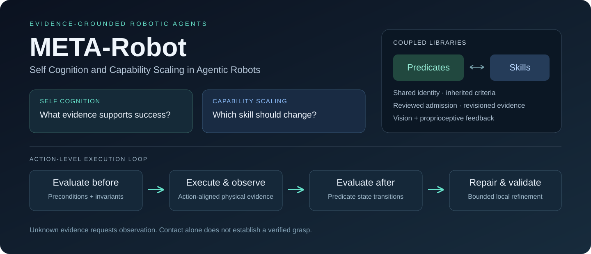
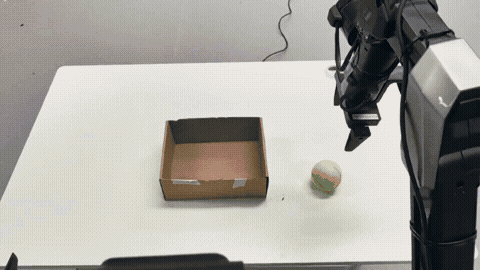
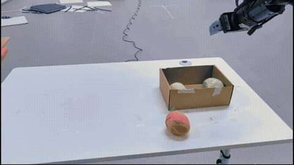
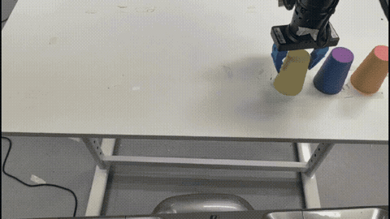
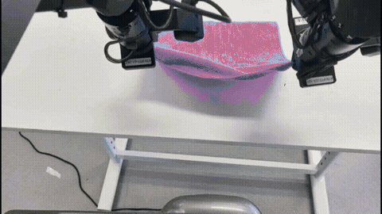
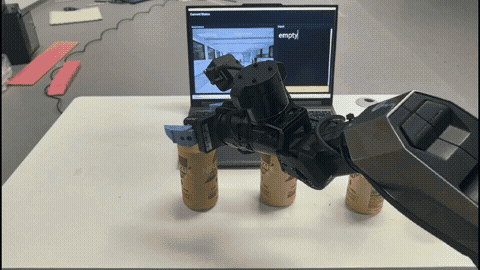
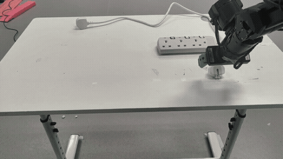

<div align="center">

# META-Robot

### 机器人智能体的自我认知与能力扩展

**让机器人学习如何执行，也学习凭什么确认执行成功。**

[English](README.md) · [仿真结果](#仿真结果) · [真机演示](#真机演示) · [谓词库](docs/predicate-library.md) · [运行接入](docs/runtime-integration.md) · [论文与代码对应](docs/paper-to-code.md)

</div>



## 核心设计

META-Robot 将可复用技能与动作级评估条件相互关联。技能描述执行或修复的方法；谓词描述动作前后应满足的条件，以及判断这些条件所需的证据。系统记录状态变化，根据未满足的条件进行有限修复，并把经过验证的标准和技能一起保存。

- **基于谓词的执行闭环**：在动作边界评估前置条件、后置条件和不变量，区分接触、夹爪闭合和确认抓取。证据缺失或过期时保留未知状态，要求补充观测。
- **谓词与技能双库**：同一谓词可被多个技能共享，子技能继承父技能的评估条件，检索时结合适用范围与可用反馈选择最具体的技能。审核通过的更新以不可变快照保存。
- **本体感知证据接入**：通过显式适配器注册视觉、关节、力、力矩或夹爪反馈，在采样充分的时间窗口中判断动态条件。

## 仿真结果

**LIBERO-Pro 任务成功率（%，越高越好）。** 下表转录自 META-Robot 论文表 1，使用 50 个评估种子。

| 方法 | Object–Pos | Object–Task | Goal–Pos | Goal–Task | Spatial–Pos* | Spatial–Task |
| :--- | ---: | ---: | ---: | ---: | ---: | ---: |
| OpenVLA | 0.00 | 0.00 | 0.00 | 0.00 | 0.00 | 0.00 |
| π₀ | 0.00 | 0.00 | 0.00 | 0.00 | 0.00 | 0.00 |
| π₀.₅ | 17.00 | 1.00 | 38.00 | 0.00 | 20.00 | 1.00 |
| CaP-Agent0 | 22.00 | 18.00 | 26.00 | 17.00 | 12.00 | 14.00 |
| ASPIRE | 98.00 | 95.00 | 81.00 | 45.00 | 51.00 | 60.00 |
| Playful / RATS | 61.00 | 63.00 | 43.00 | 36.00 | 29.00 | 31.00 |
| META-Robot (DeepSeek-V4-Flash) | 98.00 | 88.60 | 72.20 | 64.60 | 83.00 | 88.40 |
| **META-Robot (GPT-6 Astra)** | **99.60** | **99.00** | **85.80** | **69.80** | **89.25** | **95.80** |

Pos 表示位置扰动，Task 表示任务扰动。**\* Spatial–Pos：**完整系统结果仅覆盖 8 项任务，比较不同方法时需考虑这一覆盖范围差异。

<details>
<summary><b>谓词与本体感知分别带来了什么？</b></summary>

**动作级谓词消融——论文表 2。**

| 设置 | 完整 META-Robot | 移除谓词 |
| :--- | ---: | ---: |
| Object–Task | **99.00** | 85.00 |
| Object–Pos | **99.60** | 91.00 |
| Goal–Task | **69.80** | 56.00 |
| Goal–Pos | **85.80** | 69.00 |
| Spatial–Task | **95.80** | 76.00 |
| Spatial–Pos* | **89.25** | 72.00 |

**本体感知证据——独立的刚性薄物体抓取仿真（§4.5.2、图 11）。**

| 反馈条件 | 成功率（%） |
| :--- | ---: |
| 无本体感知 | 50.00 |
| 有本体感知 | **78.00** |

本体感知实验独立于上方六个 LIBERO-Pro 设置；Spatial–Pos 的覆盖范围说明同样适用于谓词消融。

</details>

来源：作者提供的 META-Robot 论文，表 1（第 7 页）、表 2 与 §4.5.2（第 9 页）。[数据与来源记录](assets/meta_robot/simulation-results.json)。以上为论文报告结果，本次主页更新未重新运行这些基准实验。

## 真机演示

以下片段来自项目实验视频；点击预览可查看对应 MP4。[完整视频](assets/meta_robot/meta-robot-full.mp4)保留全部演示与音轨。

| 指令执行 | 长时程任务 | 顺序叠杯 |
| --- | --- | --- |
| [](assets/meta_robot/instruction-following.mp4) | [](assets/meta_robot/long-horizon.mp4) | [](assets/meta_robot/ordered-stacking.mp4) |

| 毛巾操作 | 力矩辨别 | 精确插入 |
| --- | --- | --- |
| [](assets/meta_robot/towel-folding.mp4) | [](assets/meta_robot/torque-identification.mp4) | [](assets/meta_robot/precision-insertion.mp4) |

这些是提供的真实实验素材，与下方用于说明接口的合成示例分别展示。[素材记录](assets/meta_robot/media-manifest.json)保存来源哈希及裁切时间。

## 快速运行

谓词库核心支持 Linux 与 macOS、Python 3.10 及以上版本，不要求 GPU、模型密钥或仿真器。

```bash
git clone https://github.com/neo866626-blip/META-Robot.git
cd META-Robot
python3 -m venv .venv
source .venv/bin/activate
python -m pip install -e .
python -m examples.predicate_loop --output output/predicate-demo
meta-robot --library output/predicate-demo/library verify
meta-robot templates
```

示例使用标明来源的合成观测，演示双库入库、接触与确认抓取的区分、有限修复和完成门控，并输出带哈希链的状态日志。运行示例不会访问硬件。

完整仿真按[仿真部署指南](aspire/sim/README.md)配置；LIBERO-Pro、Robosuite、BEHAVIOR-1K 各有独立环境要求。真机接入请阅读[硬件部署](aspire/real/README.md)与[操作规程](aspire/real/AGENTS.md)。

## 谓词库能力

| 能力 | 接口 |
| --- | --- |
| 技能与谓词原子入库，保存审核和验证证据 | `PredicateLibrary.consolidate` |
| 多对多关联、父子继承及分类索引 | `associations`、`category_index` |
| 按适用范围与可用反馈选择最具体技能 | `retrieve` |
| 动作前后状态、证据、有限修复与执行追踪 | `PredicateCoordinator.invoke` |
| 终止谓词和必需里程碑联合门控 | `PredicateCoordinator.finish` |
| 反馈来源注册与持续信号判断 | `EvidenceCollector`、`sustained_threshold` |

完整接口见[谓词库指南](docs/predicate-library.md)，实际执行接入见[运行指南](docs/runtime-integration.md)。

## 测试与来源

```bash
python -m unittest discover -s tests -v
```

源码保留 ASPIRE 和 AlanDerp 分支的执行、感知、仿真与知识基础设施；META-Robot 的公开入口为 `meta_robot`，继承代码继续使用 `aspire` 命名空间。新增代码采用 Apache 2.0，原版权和第三方条款见 [NOTICE](NOTICE) 与[许可索引](LICENSES/README.md)。原分支说明见 [README.upstream.md](README.upstream.md)。
